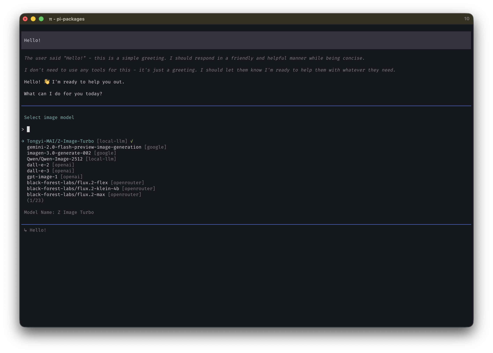

# pi-image-gen



```bash
pi install @meatroll/pi-image-gen
```

Image generation extension for [pi](https://github.com/badlogic/pi-mono). Adds a `generate_image` tool, an interactive browser edit-region selector, and `/image-model` for adding, editing and deleting image models. Models can be entered manually or imported from the providers in Pi's own `models.json`. Supports the OpenAI Images API (`/images/generations` and `/images/edits`) plus Google's native image APIs (`generateContent` for Gemini image models, `predict` for Imagen), so any OpenAI-compatible relay works.

## Features

- 🎨 **Model management** — add, edit and delete models from `/image-model`; every model lives in the plugin settings
- 🗂️ **Import from Pi's `models.json`** — list the models exposed by providers in Pi's config and copy the selected one into the plugin
- 🧭 **Add/edit wizard** — choose the image API, response format, editing support, defaults, base URL, key and multi-line headers
- ✨ **AI field help** — press `Ctrl+G` on any field to ask the current chat model for a suggestion
- 🧾 **JSON mode** — press `j` to edit the whole global settings file in a multi-line editor
- 🔌 **Any OpenAI-compatible relay** — point `baseUrl` at it and use the `openai-images` API type
- ⚙️ **Custom providers** — Point at any compatible API via settings files
- 🖼️ **Aspect ratios & resolution** — `aspectRatio` maps to `size` (OpenAI), `imageConfig` (Gemini), or `parameters.aspectRatio` (Imagen); `imageSize` maps to Gemini's 1K/2K/4K tiers
- 💾 **Flexible save modes** — Project-local, global, or custom directory
- 🎯 **`/image-model` command** — search/list focus, keyboard shortcuts, per-model options, and session persistence
- 🖱️ **Interactive editing** — The edit flow first asks whether to select a region, then launches the browser freehand lasso tool; after selection, choose the suggested prompt or write a custom one

## Install

```bash
pi install npm:@meatroll/pi-image-gen
# or from local path
pi install /path/to/pi-image-gen
```

## Usage

Just ask the agent to generate an image:

```
> Generate an image of a sunset over mountains

> Create a 16:9 wallpaper of a cyberpunk city using dall-e-3

> Make me a logo for a coffee shop, save it to the project
```

### Image-to-image editing

Pass a local image path through `imagePath` to edit an existing image. With an `openai-images` model, the extension sends a `multipart/form-data` request to `/v1/images/edits`.

In interactive Pi TUI mode, leave `maskPath` out. The extension first asks **“Select an edit area?”** and only launches a selector after you choose one:

- **Launch browser mask tool (freehand lasso)** — opens a local browser canvas where you draw freehand lasso shapes around any area at source-pixel precision. Multiple areas, undo, and clear are supported.
- **Edit whole image** — skip the mask and edit the full image.
- **Cancel** — abort without calling the image API.

After a region is saved, Pi asks whether to use the suggested prompt or write a custom one. Custom prompts start in a blank multi-line editor, so there is nothing to delete. Press Enter to confirm, Shift+Enter for a newline, or Escape to cancel.

```text
> Edit `/tmp/source.png` into a watercolor illustration while preserving the composition.
```

The selected region(s) are converted to a PNG mask automatically and saved under `.pi/generated-images/`. In non-TUI or headless mode, omitting `maskPath` edits the whole image. Pass `maskPath` only when a mask has already been prepared. For edits, the output aspect ratio defaults to the input image's nearest supported ratio unless `aspectRatio` is set explicitly.

The selected model must use the `openai-images` API type for image editing. Google models support text-to-image generation through Gemini's native API.

### Browser mask selector

The interactive edit flow can launch a local browser canvas for freehand lasso selection. It does not depend on Pi's terminal-cell resolution and supports multiple shapes, undo, and clear at source-pixel precision.

Drag to draw a loop around each area; release to close and fill it. Press Enter to save the mask or Escape to clear the current selection. After saving, Pi asks whether to use the suggested prompt or write a custom one. The selector attempts to close its browser tab automatically; if the browser blocks script-initiated tab closing, it shows a fallback message instead.

The helper binds only to `127.0.0.1`, writes the mask under `.pi/generated-images/`, and returns its path to Pi. Transparent pixels are the editable region; opaque pixels are preserved.

#### Browser selector service lifecycle

The local HTTP service starts only when the browser selector is actually launched. It is not started at Pi startup.

- **Start** — `generate_image` spawns `lib/mask-selector.mjs` after you choose the browser mask tool. The helper binds a random port on `127.0.0.1`, creates a per-run token, then opens the browser page.
- **Stop on save** — after the mask is written, the helper responds, closes the server and all connections, and exits. It then returns to Pi for the prompt choice.
- **Stop on cancel** — the Cancel button sends `/cancel`; closing the tab without saving sends a `pagehide` cancel beacon.
- **Stop on timeout or abort** — the interactive timeout defaults to 600 seconds; aborting the tool terminates the child process.

The service only serves the source image and accepts the mask for that single run. It is never a persistent daemon.

### Choosing and Managing Models

There is no built-in catalog: `/image-model` lists exactly the models declared under `providers` in the plugin settings. If the list is empty, press `a` to add the first model.

The picker has two focus areas, and the footer changes with the focused one:

- **Search** (top) — type to filter; `Tab` or `↓` moves focus to the list.
- **List** (bottom) — `↑↓` move, `Enter` select, `a` add, `e` edit, `d` delete, `j` JSON mode, `Tab` or `↑` back to search.

#### Add

`a` offers two paths:

- **Custom model…** — choose an existing provider or create one, enter the model ID and display name, pick the API/options, then supply `baseUrl`, `apiKey` and multi-line JSON `headers` when needed.
- **From Pi's models.json…** — lists every model exposed by providers in Pi's own config and imports the selected one. Pi has no image-model type, so chat models appear too; filter by name.

The add wizard asks:

1. **Image API** — `openai-images` (`/images/generations`, `/images/edits`) or `google-generative-ai-image` (Gemini `generateContent` / Imagen `predict`)
2. **Response format** — `url` or `b64_json` (OpenAI-compatible APIs only)
3. **Image editing** — whether the model supports `/images/edits`
4. **Default aspect ratio** — used when `generate_image` omits `aspectRatio`
5. **Default image size** — 1K/2K/4K (Gemini/Imagen only)

Importing writes a normal `providers.<provider>.models[]` entry into the global `pi-image-gen.json[c]`, copying `baseUrl`, `apiKey` and `headers` from Pi. From that point the model is managed independently: later changes in Pi's `models.json` are not synced.

Selecting a model that is already imported in the import flow offers **Keep the current configuration** or **Reconfigure and re-import**.

#### Edit

`e` opens a field menu for the highlighted model:

- model `name`, `id`, `api`, `responseFormat`, `supportsEdit`, `defaultAspectRatio`, `defaultImageSize`
- provider `baseUrl`, default `api`, `apiKey`, `headers`

Provider fields affect every model in that provider. Changing a model ID checks for conflicts.

#### Delete

`d` asks for confirmation and removes the model. If it was the provider's last model, the provider is removed too. If the model was the session or saved default, that selection is cleared.

#### AI help

Press `Ctrl+G` on any text or select field to ask the current chat model for a field-level suggestion. The suggestion includes a reason and confidence; apply it, ask again, or enter a value manually. AI never runs automatically, never touches `apiKey`, and never receives credentials. If the current model has no configured auth, the field falls back to manual entry.

#### JSON mode

Press `j` to edit the global settings file in a multi-line JSON editor. The extension validates the provider/model structure before writing and offers to re-edit when the JSON is invalid. Comments are lost because the file is rewritten as JSON.

```
/image-model                      # picker
/image-model meatroll/gpt-image-2 # select a configured model, or import it from Pi's models.json
```

Selection persists in the session and `pi-image-gen.state.json`; the status bar shows `🎨 provider/model`.

> [!NOTE]
> Adding, editing and deleting rewrites the global `pi-image-gen.json[c]`, so JSONC comments and formatting are lost. `.jsonc` and `.json` both work; `.json` is read first when both exist.

### Model entries

Every model is a standard settings entry and can be edited by hand or through JSON mode:

```json
{
  "providers": {
    "meatroll": {
      "baseUrl": "https://api.meatroll.shop/v1",
      "apiKey": "sk-…",
      "headers": { "User-Agent": "Mozilla/5.0 …" },
      "api": "openai-images",
      "models": [
        {
          "id": "gemini-4-argon",
          "name": "Gemini 4 Argon",
          "api": "openai-images",
          "responseFormat": "url",
          "supportsEdit": true,
          "defaultAspectRatio": "1:1"
        }
      ]
    }
  }
}
```

### No built-in models

Earlier versions shipped a generated OpenAI/Google catalog. That catalog has been removed: `providers` is now the complete model list. The OpenAI and Google examples below are ordinary provider definitions you can add with `/image-model`.

## Resolution Order

When generating an image, the model is resolved in this order:

1. **Session selection** — the last `/image-model` choice (or configured `defaultProvider`/`defaultModel`)
2. **Settings default** — `defaultProvider` / `defaultModel` from the global, state or project file
3. **First configured model**

## Configuration

### Full reference

[`settings.example.jsonc`](settings.example.jsonc) contains every supported field with inline comments — save modes, timeouts, proxy, and provider shapes (OpenAI-compatible relay, OpenAI direct, Gemini/Imagen, local server). A copy lives at `~/.pi/agent/settings/pi-image-gen.example.jsonc` for reference while editing.

The loader accepts JSONC: `//` line comments, `/* */` block comments and trailing commas are stripped before parsing, so the example can be pasted straight into your config. Both `pi-image-gen.json` and `pi-image-gen.jsonc` are read (`.json` first), globally and per project.

Picks made through `/image-model` store the last selection in `pi-image-gen.state.json`. Adding, editing or importing a model writes it into the global `pi-image-gen.json[c]`, which rewrites that file and drops JSONC comments. Press `j` in `/image-model` to edit that file as JSON.

Two rules that surprise people:

- `providers` is the complete model list. Every model you want must be declared there; there is no fallback catalog.
- `saveDir` is used verbatim — `~` is not expanded. Use an absolute path.

### Custom Models via Settings

Define image providers in `~/.pi/agent/settings/pi-image-gen.json[c]` (global) or `<project>/.pi/settings/pi-image-gen.json[c]` (project-local, overrides global):

```json
{
  "defaultProvider": "local-llm",
  "defaultModel": "my-local-image-model",
  "providers": {
    "local-llm": {
      "baseUrl": "http://192.168.1.51:9999/v1",
      "apiKey": "MY_API_KEY",
      "headers": { "User-Agent": "My Relay Client" },
      "api": "openai-images",
      "responseFormat": "b64_json",
      "models": [
        {
          "id": "my-local-image-model",
          "name": "My Local Image Model",
          "cost": 0,
          "responseFormat": "url",
          "supportsEdit": true,
          "defaultAspectRatio": "16:9",
          "defaultImageSize": "1K"
        }
      ]
    }
  }
}
```

Model entries accept `responseFormat`, `supportsEdit`, `defaultAspectRatio` and `defaultImageSize` — the same fields the add/edit wizard writes. `api` can be set per model to override the provider.

For providers whose signed image URLs require server-side authentication, set `responseFormat` to `b64_json`. The extension also accepts a server-owned `data:image/...;base64,...` URL and saves it directly without making a second request to the provider.


| Type | Used By | Endpoint |
|------|---------|----------|
| `openai-images` | OpenAI direct and any OpenAI-compatible relay | `POST /v1/images/generations` for text-to-image; `POST /v1/images/edits` when `imagePath` is supplied |
| `google-generative-ai-image` | Google Gemini / Imagen | `POST /models/{id}:generateContent` for Gemini image models; `POST /models/{id}:predict` for `imagen-*` models |

Model-level `api` overrides provider-level `api`.

## Save Modes

Images are always saved locally so every result includes a reusable file path and download link. The default location is the project directory.

| Mode | Location |
|------|----------|
| `project` | `<repo>/.pi/generated-images/` (default) |
| `global` | `~/.pi/agent/generated-images/` |
| `custom` | `saveDir` param or `saveDir` in config |
| `none` | Legacy value; falls back to `project` |

The TUI result shows the absolute local path and a clickable `Download image` link when the terminal supports OSC 8 hyperlinks. In terminals without hyperlink support, it shows the `file://` URL as text.

## Tool Parameters

The `generate_image` tool accepts:

| Parameter | Type | Default | Description |
|-----------|------|---------|-------------|
| `prompt` | string | *required* | Description of the image to generate or edit. After a region is selected, this is offered as the suggested prompt; choose it or write a custom prompt |
| `imagePath` | string | — | Local input image path or `file://` URL; uses `/v1/images/edits` with an `openai-images` model. In interactive TUI, omit `maskPath` and the tool first asks whether to select an edit area |
| `maskPath` | string | — | Optional prepared mask path or `file://` URL for localized edits; requires `imagePath`. Omit to be asked whether to select interactively |
| `aspectRatio` | string | configured default, else `1:1` for generation; input ratio for edits | `1:1`, `2:3`, `3:2`, `3:4`, `4:3`, `4:5`, `5:4`, `9:16`, `16:9`, `21:9` |
| `imageSize` | string | configured default, else `1K` | `1K`, `2K`, `4K` — sent as Gemini `imageConfig.imageSize`; the OpenAI Images API has no equivalent and ignores it |
| `quality` | string | `auto` | `auto`, `low`, `medium`, `high` (OpenAI direct only) |
| `save` | string | `project` | `project`, `global`, or `custom`; images are always saved locally |
| `saveDir` | string | — | Directory for `save=custom` |
| `timeout` | number | `600` | Generation timeout in seconds |

## Pi Integration

- **API keys & headers** — Values declared in the plugin `providers` win (imported models copy them from Pi); Pi's registry fills the rest via `ctx.modelRegistry.getApiKeyAndHeaders()` (env vars, auth.json, OAuth, `models.json`)
- **Base URLs** — From the plugin `providers`, then Pi's `models.json` (provider or model level), then Pi's registry
- **Model list** — the plugin `providers` config only; Pi `models.json` is read-only and used for importing models
- **Custom providers** — Add with `/image-model` or define in `~/.pi/agent/settings/pi-image-gen.json`
- **Image edits** — Use `imagePath` and optional `maskPath` with an `openai-images` model that has editing enabled; omitting `maskPath` in the TUI first asks whether to select a region
- **Mask selection** — The browser selector can create a mask inside Pi's interactive edit flow

## Architecture

Mirrors Pi's text model pipeline:

| Layer | Pi (text) | pi-image-gen |
|-------|-----------|--------------|
| Model sources | models.dev, OpenRouter, AI Gateway, `models.json` | `providers` in the plugin settings |
| Custom models | `models.json` providers | `/image-model` add/edit or hand-written settings entries |
| API key & header resolution | `ModelRegistry.getApiKeyAndHeaders()` | Plugin `providers` first, then `ModelRegistry.getApiKeyAndHeaders()` |
| Model selection | Ctrl+P / model selector | `/image-model` (search + list focus, add/edit/delete) |

### Model Priority

1. **Settings providers** — `providers` in `pi-image-gen.json` is the only source of models
2. **Session selection** — `/image-model` overrides the saved defaults
3. **Defaults** — `defaultProvider`/`defaultModel`, then the first configured model

## Adding Providers

1. Press `a` in `/image-model` (custom model or import from Pi's `models.json`), or
2. press `j` to edit the global settings as JSON, or
3. add a `providers` entry to `~/.pi/agent/settings/pi-image-gen.json` by hand
4. Add generation logic in `extensions/image-gen.ts` if a new API type is needed

## License

[MIT](LICENSE)
